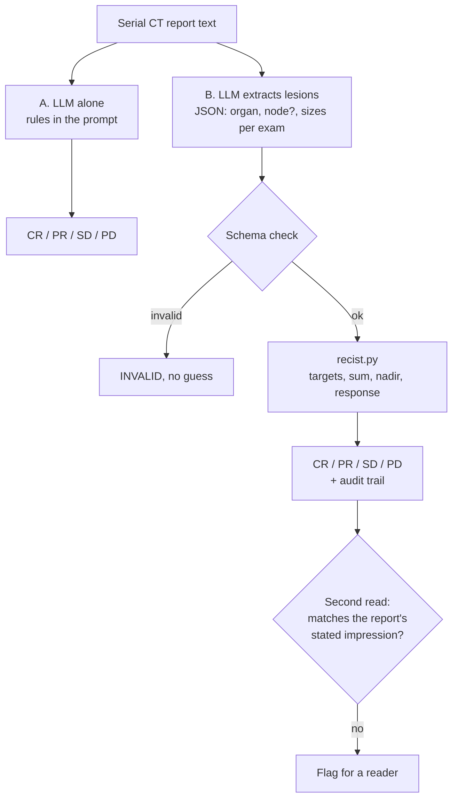

# SecondRead

**Let the LLM read. Let code decide.** A small study of RECIST 1.1 response assessment from serial CT reports.

Inspired by Nucleo Research's public use case *"Target vs Non-Target Lesion Classification (RECIST)"*.
An outside idea, built to learn; **not affiliated with Nucleo**. All 60 patients are synthetic. No patient data.
Not a medical device and not clinically validated.

## The question
If a language model has the RECIST 1.1 rules in its prompt, can it give the response category (CR / PR / SD / PD)
by itself? Or should it only extract the measurements, and leave the decision to deterministic code that
can show its work?



In a real pipeline the measurements would come from an imaging model, not report text. `recist.py` is written to
sit after either: it takes lesion sizes over time and returns the response **with the rule and numbers behind it**:

```
Segment 6 liver lesion: target, longest diameter 60 mm
PD: sum 62 mm vs nadir 50 mm = +12 mm (+24.0%), needs >= +20% and >= +5 mm
overall PD: target PD, non-target NA, no new lesions
```

## Results (run 2, 60 cases: 20 hand-made edge cases + 40 random)

| Model (local, Ollama) | A. LLM alone | A on edge cases | B. LLM extracts, code decides | B on edge cases | Clean extractions |
|---|---|---|---|---|---|
| qwen3.8:27b | 44/60 (73%) | 8/20 | **59/60 (98%)** | **20/20** | 60/60 |
| qwen2.5:7b-instruct | 37/60 (62%) | 12/20 | **57/60 (95%)** | **19/20** | 34/60 |
| Oracle (true sizes → `recist.py`) | | | 60/60 | 20/20 | |

**Second read.** 17 reports carry a deliberately wrong impression. Pipeline B with the 27B model flagged all 17,
with 1 false alarm (7B: 16 of 17, 2 false alarms).

Where the LLM alone fails, even the 27B model with the rules in front of it: +19% vs +20%, "+20% but only +4 mm",
progression measured from the nadir instead of the baseline, short axis vs long axis for lymph nodes,
the 2-per-organ limit, a residual 8 mm node in a complete response. Exactly the arithmetic and bookkeeping
that code does reliably and a reviewer can audit.

The 20 edge cases, their hand-written labels and the reasons are in [`make_cases.py`](make_cases.py);
every raw model answer is kept in `results/` (run 2) and `results_v1/` (run 1).

## How it was built: [`BUILD_LOG.md`](BUILD_LOG.md)
Built in Claude Code with Claude Fable 5.2 as the coding agent; I reviewed every step. The build log records each
time the work was wrong and what caught it. Three lessons:

1. **A bad score can be my prompt.** In run 1 the 7B model scored 55% in pipeline B. Reading the raw outputs showed
   it returned one lesion for 55 of 60 reports, because my JSON example had one lesion. With a two-lesion example:
   95%. Read the outputs before believing a number.
2. **A failure with a clean extraction means check the label first.** The 27B model's only run-1 "miss" was a
   wrong gold label from my generator, not a model error.
3. **Some calls belong to a reader.** The 27B model's one remaining miss: a non-target node regrew from 2 to
   10 mm while every target vanished, and the model called it "unequivocal progression". That is a clinical
   judgement; the next step is to accept that flag only when the report states it, and otherwise mark REVIEW.

## Limits
- Synthetic, template-style reports; real reports are messier. 60 cases is a small set.
- Text in, not images. No clinical validation, no reader study.
- Assumptions to confirm against the RECIST 1.1 paper: lymph nodes count as one organ for the 2-per-organ limit;
  ties between equal lesions are broken by name.
- Reference: Eisenhauer et al., *New response evaluation criteria in solid tumours: revised RECIST guideline
  (version 1.1)*, Eur J Cancer 45 (2009) 228–247.

## Run it
Python 3.9+, standard library only. [Ollama](https://ollama.com) for the LLM part.

```bash
python3 -m unittest            # 33 tests: every RECIST rule has a hand-made case
python3 make_cases.py          # writes cases.json (fixed seed)
ollama pull qwen2.5:7b-instruct
python3 run_eval.py qwen2.5:7b-instruct   # add more model names to compare
```

| File | What it does |
|---|---|
| `recist.py` | Target selection, sum of diameters, nadir, CR/PR/SD/PD, overall response, audit trail |
| `test_recist.py` | One hand-made case per rule |
| `make_cases.py` / `test_cases.py` | Synthetic patients, report text, gold labels; checks the edge labels agree with the rules |
| `run_eval.py` | Pipelines A and B, extraction error tags, second-read check, cached raw outputs |

Mert Barut · [mertbarut.me](https://mertbarut.me)
