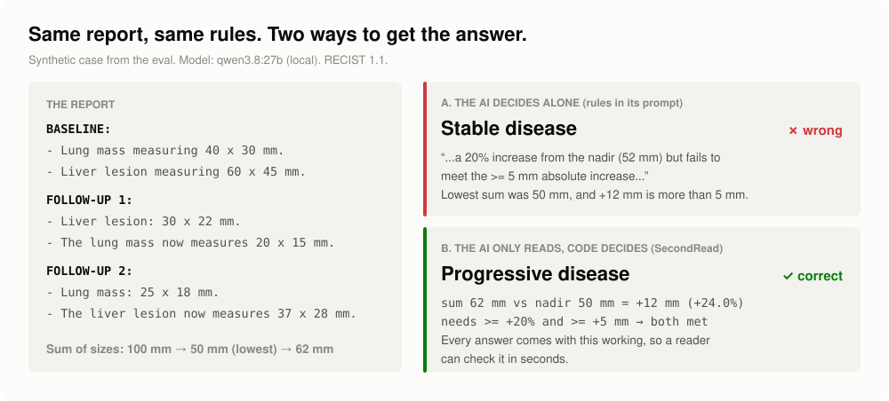
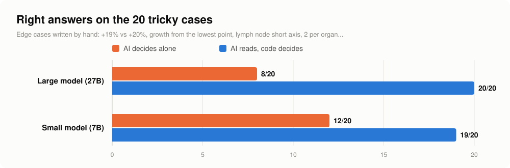
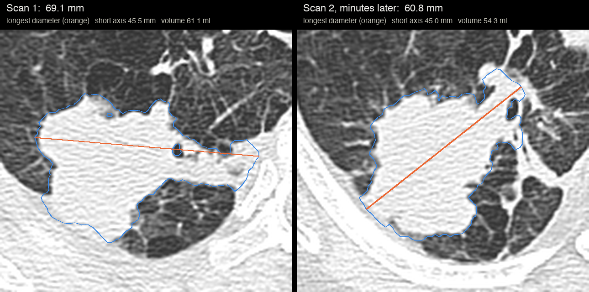
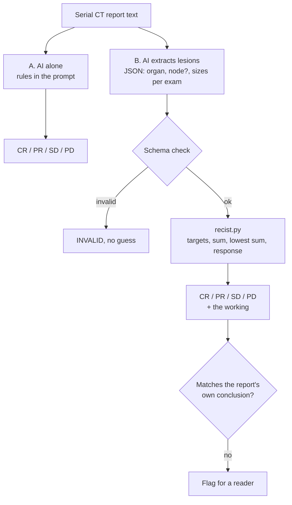

# SecondRead

**Let the AI read. Let code decide.** Tumor response (RECIST 1.1) from serial CT reports, tested on 60 cases.

<picture>
  <source media="(prefers-color-scheme: dark)" srcset="figures/hero-dark.svg">
  
</picture>

A language model with the RECIST rules in its prompt still slips on the arithmetic and the bookkeeping:
the lowest earlier sum, +19% vs +20%, a lymph node's short axis, the 2-per-organ limit.
So SecondRead splits the job. The model only copies the lesions and sizes out of the report.
Plain, tested code applies the rules and **shows its working**, so a reader can check any answer in seconds.

<picture>
  <source media="(prefers-color-scheme: dark)" srcset="figures/edge-cases-dark.svg">
  
</picture>

## From a real scan to a verdict

The rule engine needs measurements. On a public lung CT (RIDER, TCIA), `measure.py` reads an expert's tumor
outline and measures it the RECIST way; `recist.py` then gives the verdict with its working.
This patient was scanned **twice, minutes apart**, so nothing really changed:



| Outline | Scan 1 | Scan 2 | Change | Verdict from `recist.py` |
|---|---|---|---|---|
| Drawn by hand | 69.1 mm | 60.8 mm | **-12%** | Stable disease |
| Automatic | 59.4 mm | 60.6 mm | +2% | Stable disease |

The verdict is right both times. But the hand-drawn outlines alone moved the number by 12%, more than half
of the 20% that would be called progression. The arithmetic is the easy part to make reliable; the measurement
going in is where the noise lives. One patient, so this is an illustration, not a statistic.
Data source and licence: [`DATA.md`](DATA.md).

**It also works as a second reader.** 17 reports carry a deliberately wrong conclusion. With the large model,
SecondRead flagged all 17, with one false alarm.

## What I learned building it
Built in Claude Code with Claude Fable 5.2 as the coding agent. I reviewed every step and logged every mistake
in [`BUILD_LOG.md`](BUILD_LOG.md).

- **A bad score can be my own prompt.** The small model first scored 55%. Its raw answers showed it listed one
  lesion per report, copying my one-lesion example. A two-lesion example: 95%.
- **When the extraction is perfect but the answer is "wrong", check the answer key.** That's how I found a bug in
  my own test data.
- **Some calls belong to a human.** The one case the large model still misses is a clinical judgement
  (did a 10 mm node "unequivocally" progress?). Next step: accept that only when the report says it, else flag it.

Inspired by Nucleo Research's public use case *"Target vs Non-Target Lesion Classification (RECIST)"*.
An outside idea built to learn, **not affiliated with Nucleo**. All cases are synthetic, no patient data.
Not a medical device.

<details>
<summary><b>Full results</b> (60 cases: 20 hand-made edge cases + 40 random)</summary>

| Local model (Ollama) | AI alone | on edge cases | AI reads, code decides | on edge cases | Clean extractions |
|---|---|---|---|---|---|
| qwen3.8:27b | 44/60 (73%) | 8/20 | **59/60 (98%)** | **20/20** | 60/60 |
| qwen2.5:7b-instruct | 37/60 (62%) | 12/20 | **57/60 (95%)** | **19/20** | 34/60 |
| True sizes → `recist.py` | | | 60/60 | 20/20 | |

Every raw model answer is saved: run 2 in `results/`, run 1 (before the prompt fix) in `results_v1/`.
The edge cases and their hand-written labels are in [`make_cases.py`](make_cases.py).
</details>

<details>
<summary><b>How it works</b></summary>



In a real pipeline the sizes would come from an imaging model, not report text. `recist.py` sits after either one.

| File | What it does |
|---|---|
| `recist.py` | Target selection, sum of diameters, nadir, CR/PR/SD/PD, overall response, the working |
| `test_recist.py` | One hand-made case per rule (33 tests) |
| `make_cases.py` / `test_cases.py` | Synthetic patients, report text, gold labels |
| `run_eval.py` | Both pipelines, extraction error tags, second-reader check |
| `make_figures.py` | The two figures above, drawn from the saved results |
| `measure.py` / `repeat_scan.py` | CT + expert outline → longest diameter, short axis, volume → `recist.py` (needs pydicom, numpy, pillow) |
</details>

<details>
<summary><b>Limits</b></summary>

- Synthetic, template-style reports; real reports are messier. 60 cases is a small set.
- The report eval is text only. The image step covers one public patient and measures from an existing expert
  outline; it does not find or outline tumors itself. No clinical validation, no reader study.
- `measure.py` takes the longest distance between two outline points in one slice; on a concave tumor that
  line can cross tissue outside the outline, which a human reader would avoid.
- Assumptions to confirm against the RECIST 1.1 paper: lymph nodes count as one organ for the 2-per-organ limit;
  ties between equal lesions are broken by name.
- Reference: Eisenhauer et al., *New response evaluation criteria in solid tumours: revised RECIST guideline
  (version 1.1)*, Eur J Cancer 45 (2009) 228–247.
</details>

<details>
<summary><b>Run it</b></summary>

Python 3.9+, standard library only. [Ollama](https://ollama.com) for the model part.

```bash
python3 -m unittest
python3 make_cases.py
ollama pull qwen2.5:7b-instruct
python3 run_eval.py qwen2.5:7b-instruct   # add more model names to compare
python3 make_figures.py
```
</details>

Mert Barut · [mertbarut.me](https://mertbarut.me)
